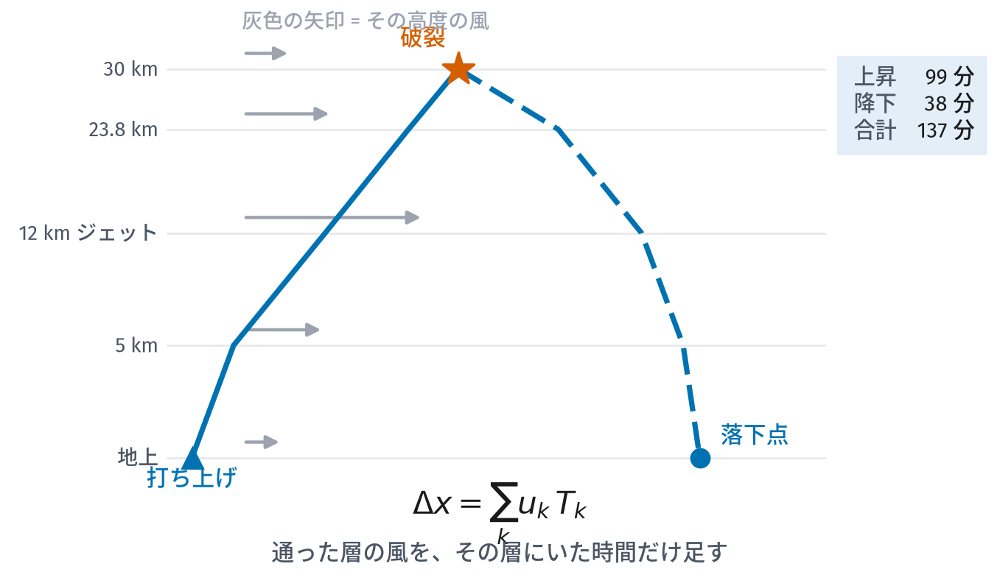
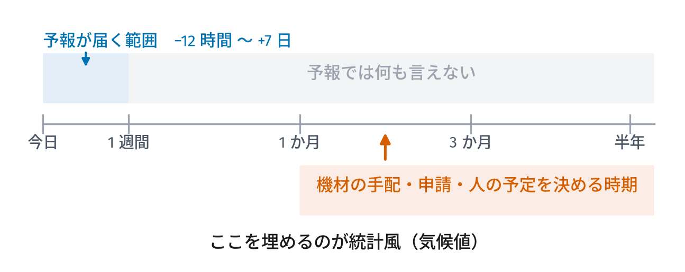
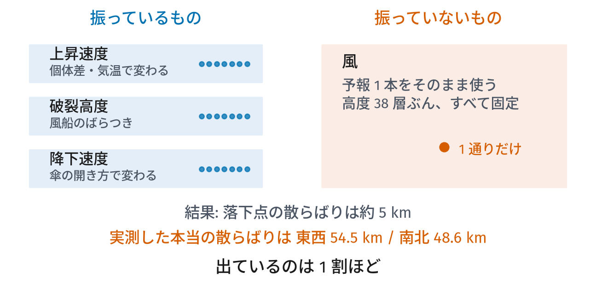
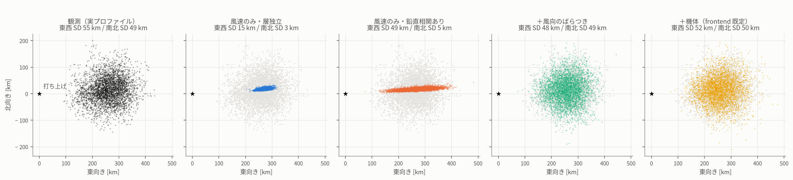
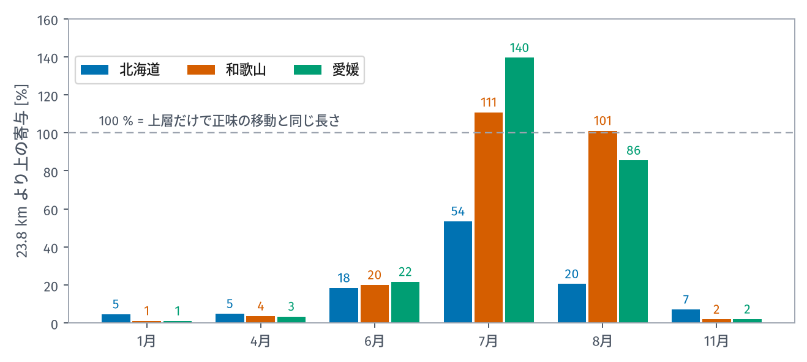
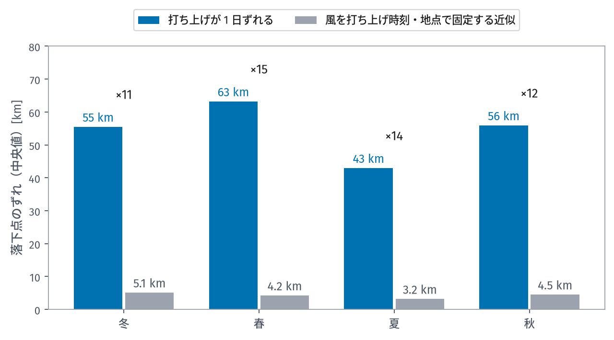

スペースバルーンを飛ばすと、機体は風に流されて数十〜数百 km 先に落ちます。どこに落ちるかを事前に知りたい。そのための予測器はすでにあり、広く使われています。

ところが、その予測器で計算できるのは**7 日先まで**です。この記事では、その制限と、7 日より先の打ち上げについて落下点をどう見積もるかを書きます。

全 3 回の 1 回目です。

1. **落下予測は 7 日先で止まる**（この記事）
2. [再解析 10 年ぶんから統計風を作る][part2]
3. [DuckDB で配る、そして使う][part3]

:::message
気象や統計が専門でない人に向けて書いています。専門用語は出てきたところで説明します。
:::

## 落下点は「通った層の風の足し算」

まず、なぜ落下予測が難しいのかを確認しておきます。

スペースバルーンはエンジンを持ちません。上昇中も降下中も、ただ風に流されます。地上から 30 km まで上がり、そこで破裂して降りてくるまで、だいたい 2 時間ちょっと。その間ずっと、その瞬間その高度にある風に押され続けます。

つまり落下点は、**通った層の風を、その層にいた時間だけ足し合わせたもの**です。

$$
\Delta x = \sum_k u_k T_k
$$

$u_k$ が $k$ 番目の層の風、$T_k$ がその層にいた時間です。この記事で使う標準的な設定（上昇 5 m/s、破裂 30 km、降下は海面相当 6 m/s）だと、上昇に 99 分、降下に 38 分、合計 137 分かかります。

ここで重要なのは、**どの高度の風も無視できない**ということです。地上付近の風だけでも、上空のジェット気流だけでも、落下点は求まりません。高度 12 km 付近のジェットは最も速いので寄与が大きいのですが、そこを通過する時間は短い。逆に地上付近はゆっくり通りますが風が弱い。全部足して初めて答えが出ます。

## 予報は 7 日で終わる

この足し算をやってくれるのが、CUSF（ケンブリッジ大学宇宙飛行部）が作った
**Tawhiri** という予測器です。打ち上げ地点・時刻・上昇速度・破裂高度・降下速度を
渡すと、軌道を積分して落下点を返してくれます。スペースバルーンの界隈ではほぼ標準の
道具で、SondeHub が公開インスタンスを運用しています。

便利なのですが、Tawhiri が使っているのは **GFS**（アメリカの数値予報モデル）の
予報値です。予報である以上、期間に限りがあります。範囲の外の日時を投げると、
Tawhiri は `outside dataset` というエラーを返して終わりです。データが無いのだから
当然です。

**実際に使えるのは、おおむね現在から 1 週間先まで**。時間にして約 169 時間です。

問題は、打ち上げの計画がこの範囲で終わらないことです。

機材を手配し、申請を出し、人の予定を押さえる。回収に船が要るなら手配はさらに
早い。どれも数か月前から動きます。そして「いつ上げるか」は、その全部より先に
決めなければいけません。

**「半年後のこの週に上げたら、どのくらい流されるのか」**。この問いに、予報は
原理的に答えられません。

## モンテカルロで風がばらついていない

予報の期間とは別に、落下点の散らばりの出し方にも問題があります。影響はこちらの
ほうが大きいです。

落下点は 1 点で出しても意味がありません。上昇速度も破裂高度も毎回ばらつくので、
「このあたりに落ちる」という範囲が要ります。そこで普通は**モンテカルロ**を使い
ます。パラメータを乱数で振って何百通りも飛ばし、落下点の散らばりを 50 / 90 / 95 %
の楕円として描く。

ここで振られるのは、たいてい機体側の 3 つだけです。

**上昇速度・破裂高度・降下速度。風は振りません**。予報値 1 本をそのまま、
高度 38 層ぶん全部固定して使う。風は「与えられた条件」であって「ばらつくもの」
とは扱われていないわけです。

風を固定すると散らばりがどれだけ小さく出るのか、実際に測ってみました。和歌山の冬、10 年ぶんの解析値
3,612 本を使って、落下点の散らばりを 5 通りの方法で再現した結果がこれです。

*左端が実際のプロファイルで飛ばした「答え」。右へ行くほど再現の手を加えている。打ち上げ地点は★。（この検証は和歌山で実施）*

左端の黒が本当の散らばりです。**東西 SD 55 km / 南北 SD 49 km**。ずいぶん広い。

いちばん右のオレンジが、機体パラメータを振るやり方に**風のばらつきを足した**
ものです。両者はほぼ一致しています。

では機体パラメータ「だけ」だとどうなるか。この図には描かれていませんが、答えは
**約 5 km** です。実際は 50 km 散らばるところを、5 km と見積もっていることになります。

:::message alert
つまり機体だけを振るモンテカルロは、**実際に起こりうる散らばりの 1 割程度**しか
出していません。楕円に含まれているのは機体のばらつきだけで、
天気によるばらつきは入っていません。
:::

この図からはもう 2 つ読み取れます。どちらも 3 回目で使うので、覚えて
おいてください。

**2 番目のパネル（青）— 層を独立に振ると縮む**。各高度の風速を勝手にばらばらに
振ると、東西の散らばりが 15 km まで縮みます。3 番目（朱）のように鉛直方向の
相関を入れると 49 km に戻る。実際の大気では、ある高度で風が強い日はその上下でも
強いからです。独立に振ると打ち消し合ってしまう。

**3 番目と 4 番目の差 — 風向を固定すると横風が消える**。風速だけ振って風向を
固定すると、南北の散らばりが 5 km しか出ません（本当は 49 km）。風向を振って
初めて一致します。ちなみに和歌山の冬の 200 hPa は定常度 0.98、つまり「ほぼ毎回
同じ向き」です。それでも円周標準偏差は 11.5° あり、
`264 km × tan(11.5°) = 54 km` になる。**定常度が 1 に近くても、風向を固定してよいことにはなりません**。

## 気圧面データは高度 24 km までしかない

もう 1 つ、別の問題もあります。Tawhiri を使わず自分で軌道を積分する場合、
風は公開されている気圧面データから取ってくることに変わりません。ところが、無償で
手に入るものの多くは**高度 24 km あたりで止まります**。たとえば Open-Meteo の
気圧面予報は 30 hPa（約 23.8 km）が最上層です。

30 km で破裂する飛行なら、その上は飛行時間の 17 % を占めます。最上層の風をその
まま上へ引き伸ばして代用するしかない。

この代用でどれだけずれるかを見るため、23.8 km より上の層が水平移動に占める割合を測りました。

*月ごと・領域ごと。100 % は「上層だけで正味の移動と同じ長さ」を意味する*

冬はほぼ無視できます。北海道の 1 月で 4.6 %、和歌山と愛媛（愛南町の周辺）は 1 % 前後。この季節なら
23.8 km で打ち切っても実害はありません。

ところが夏は違います。北海道の 7 月で **54 %**。移動の半分以上を生む部分を、
最上層の風で代用していることになります。

和歌山の 7 月は **111 %**、愛媛は **140 %** です。100 % を超えるのは分母が**正味**の移動距離だから
で、夏の成層圏は東風、その下は西風なので互いに打ち消し合っているのです。つまり
**上層を無視すると、距離が足りないどころか向きが逆に出る**。

夏は飛行距離が短く回収しやすいので、打ち上げに向いた季節です。北海道で飛行距離が
最短になるのは 7 月後半で、平均 62 km。冬の 3 分の 1 以下です。その夏に、上層の
風が欠けている影響が最も大きくなります。

## では何が要るのか

予報が出ていない数か月先について知りたいのは、「**その時期の風はだいたいどうなっているか**」です。

10 月下旬に北海道から上げたら、平年ならどちらへ何 km 流れるのか。ばらつきはどのくらいか。年によってどれだけ違うのか。これは予報の問いではなく、**統計の問い**です。

気象の世界ではこれを**気候値**（climatology）と呼びます。過去の実績をたくさん集めて、「この時期はこうなりがち」を数字にしたもの。予報の代わりではありません。役割が違います。

| | 予報 | 気候値（統計風） |
|---|---|---|
| 答える問い | 明後日はどうなるか | この時期はどうなりがちか |
| 対象にできる期間 | 7 日先まで | 何年先でも |
| 精度 | その日については高い | 特定の日については何も言わない |
| 使いどころ | 当日の可否判断 | 日程と場所の計画 |

[2 回目の記事][part2]では、この気候値を JRA-3Q という再解析データの 10 年ぶんから実際に作る話をします。

## 気候値にできないこと

ただし、気候値でできないこともあります。

私たちは北海道の全格子点・10 年ぶんについて、実際に軌道を積分して誤差を測りました。**832 万本**の飛行です。結果は次のとおりです。

*青が「打ち上げが 1 日ずれたとき」、灰色が「風を打ち上げ時刻・地点で固定する近似」。どちらも落下点のずれの中央値。上の ×N が両者の比*

| 季節 | 飛行距離（中央値） | 風を固定する近似の誤差 | **打ち上げが 1 日ずれたときの移動** |
|---|---:|---:|---:|
| 冬 | 176 km | 5.1 km | **55.5 km** |
| 春 | 134 km | 4.2 km | **63.2 km** |
| 夏 | 73 km | 3.2 km | **43.0 km** |
| 秋 | 164 km | 4.5 km | **55.9 km** |

**打ち上げが 1 日ずれると、落下点は 43〜63 km 動きます**。飛行距離の 3〜6 割です。

一方、「風を打ち上げ地点・打ち上げ時刻で固定する」という現在のシミュレータの近似は、3〜5 km しかずれません。**約 12 倍の差**があります。

ここから 2 つのことが言えます。

1. **風を固定する近似を直しても、落下点の精度はほとんど上がらない**。もっと大きな誤差の原因が他にあります
2. **気候値で「10 月 20 日の落下点」を言い当てることはできない**。1 日違えば 50 km 動くのですから

気候値が答えられるのは「10 月下旬に上げるなら、おおむねこちらへこのくらい、ばらつきはこのくらい」までです。当日の判断は予報でやるしかありません。

当日の判断には予報を使い、日程や場所の計画には気候値を使う。これがこの記事の結論です。

## 次回

2 回目は、その気候値を実際に作る話です。10 年ぶんの再解析データから統計を取るのですが、単に平均すればいいわけではありませんでした。

- 時期はどこまで細かく切れるのか（答えは 15 日でした）
- 風向を平均してはいけない理由（359° と 1° の平均は 180° になる）
- そして北海道では、**時期を知っても落下位置の誤差が 17 % しか減らない**という結果

---

## 図とデータについて

この記事の図のうち、実データに基づくもの（落下点の散らばり、1 日ずれの比較）は **JRA-3Q 再解析**から作った派生物です。JRA-3Q は気象庁が作成し、NSF NCAR GDEX がデータセット `d640000` として配布しています。

これらの図は **CC BY-NC-SA 4.0**（表示・非商用・継承）で提供されます。本文とコードは別のライセンスです。

> Kosaka, Y., S. Kobayashi, Y. Harada, C. Kobayashi, H. Naoe, K. Yoshimoto, M. Harada, N. Goto, J. Chiba, K. Miyaoka, R. Sekiguchi, M. Deushi, H. Kamahori, T. Nakaegawa, T. Y. Tanaka, T. Tokuhiro, Y. Sato, Y. Matsushita, and K. Onogi, 2024: The JRA-3Q Reanalysis. *J. Meteor. Soc. Japan*, **102**, 49-109. doi:10.2151/jmsj.2024-004

北海道の統計風データは、DuckDB ファイルとして**配布を予定しています**。中身と使い方は[3 回目][part3]に書きます。

<!-- 公開時にここだけ書き換える。your-id を自分の Zenn ID に。 -->

[part1]: https://zenn.dev/your-id/articles/balloon-wind-1-forecast-limit
[part2]: https://zenn.dev/your-id/articles/balloon-wind-2-building-climatology
[part3]: https://zenn.dev/your-id/articles/balloon-wind-3-duckdb-distribution
