[前回][part1]は、スペースバルーンの落下予測が 7 日先で止まること、そして現在のモンテカルロが風を振っていないために散らばりを 1 割しか出していないことを書きました。

今回は、その問題を解決するための**統計風**を実際に作る話です。過去 10 年ぶんの上空の風を集めて「この時期はこうなりがち」を数字にする。やることは単純に見えますが、単純に平均すると誤った結果になる箇所がいくつもありました。

1. [落下予測は 7 日先で止まる][part1]
2. **再解析 10 年ぶんから統計風を作る**（この記事）
3. [DuckDB で配る、そして使う][part3]

## 材料: 再解析データ

過去の上空の風を知りたいとき、「観測データを探す」という発想はうまくいきません。ラジオゾンデ（気球で飛ばす観測機器）は 1 日 2 回、限られた地点でしか上がっていないからです。北海道の任意の地点の、任意の高度の、6 時間ごとの風は、どこにも観測されていません。

そこで使うのが**再解析**（reanalysis）です。

:::message
**再解析とは**: 過去の観測を、同じ 1 つの数値モデルと同じ同化手法で計算し直したデータ。観測値そのものではなく、観測とモデルを突き合わせた**推定値**です。

なぜ「し直す」のか。予報の現場で使うモデルは年々改良されるので、当時の予報値をそのまま並べると、精度がだんだん良くなる不均一なデータになってしまいます。長期の統計を取るには、最初から最後まで同じ手順で作り直す必要があるのです。
:::

再解析はいくつもあります。どれを使うかは、主に**上端の高度**で決めました。

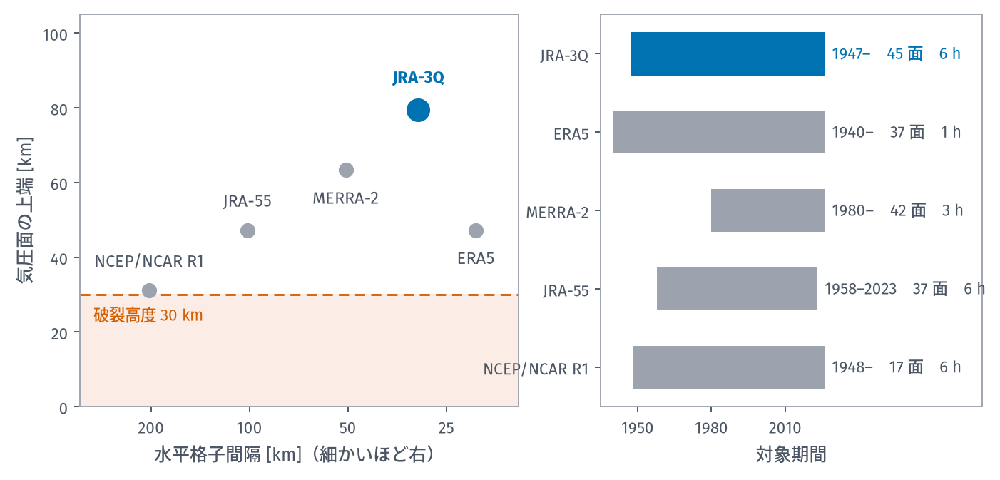
*左が「どこまで細かく・どこまで高く」、右が対象期間。破裂高度 30 km（朱の線）に余裕をもって届くことが条件になる*

破裂高度 30 km に届かないデータは、この用途では使えません。NCEP/NCAR R1 は
上端が 10 hPa（約 31 km）でぎりぎり届くものの、格子が約 200 km と粗すぎます。
JRA-55 は 1.25 度格子で、和歌山の箱にわずか 4 点しか入りません。

選んだのは **JRA-3Q**（気象庁第 3 次長期再解析）です。理由は 3 つ。

- 気象庁自身の製品で、日本周辺のラジオゾンデ・衛星データが密に同化されている
- 気圧面が 0.01 hPa（約 80 km）まである。30 km 破裂には十分すぎる
- NSF NCAR GDEX から匿名で無償取得できる

:::details ERA5 ではないのか
ERA5 のほうが細かいです。水平 20 km（JRA-3Q は 31 km）、1 時間ごと（6 時間ごと）、上端 1 hPa（約 48 km）。仕様だけを比べれば ERA5 が上です。

今回 JRA-3Q にしたのは、同じプロジェクトの別メンバーが ERA5 で並行して進めていたからで、「JRA-3Q のほうが日本周辺で良いはず」という期待は**検証していない推測**です。事実として測ったわけではありません。
:::

取ってきた範囲はこうです。

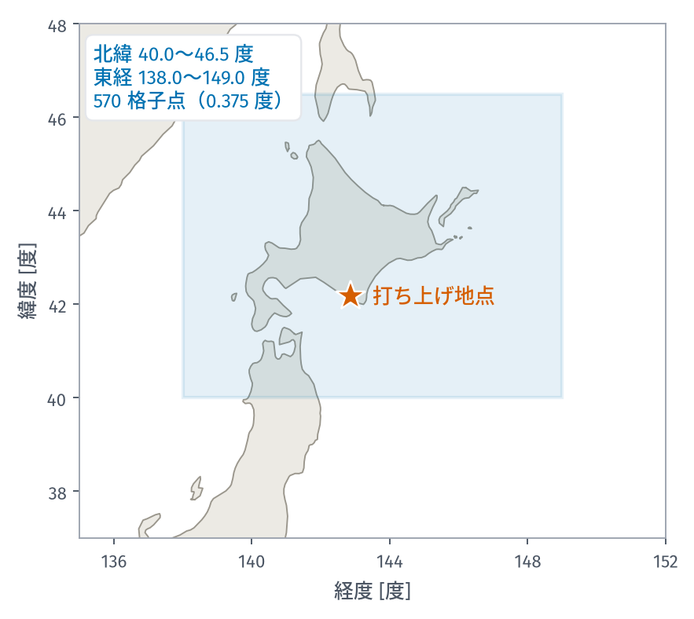
*青い箱が集計した範囲。星が代表にとった打ち上げ地点*

| | |
|---|---|
| 領域 | 北緯 40.0〜46.5 度、東経 138.0〜149.0 度 |
| 格子点 | **570 点**（0.375° ≒ 約 40 km 間隔） |
| 気圧面 | **38 面**（1000〜3 hPa、高度にして約 0.1〜40 km） |
| 時間 | 6 時間ごと（00/06/12/18 UTC）× 10 年 = **14,610 時刻** |
| 期間 | 2016〜2025 年 |
| 変数 | 東西風 $u$、南北風 $v$、ジオポテンシャル高度 $Z$ |

以降の図は、北海道の南岸に代表として置いた**打ち上げ地点**（北緯 42.1823 度、
東経 142.8510 度）のものです。最寄り格子点まで 4.7 km。ここに限った話ではなく、
領域内のどの格子点でも同じことができます。

## どこまで細かく時期を切れるか

「10 月下旬の風」を知りたいわけですが、では「下旬」とはどのくらいの幅なのか。週単位で切るべきか、月単位か。

これは好みの問題ではなく、**データから区別できるかどうか**の問題です。細かく切るほど 1 区間あたりの標本が減り、たまたまのばらつきを「季節の特徴」と読み違えてしまいます。

測り方はこうしました。10 年のうち 1 年を抜いて残り 9 年で統計を作り、抜いた 1 年をどれだけ正確に予測できるかを見る。これを 10 通り繰り返す（1 年抜き交差検証）。区間幅を変えながらやれば、誤差がいちばん小さくなる幅が分かります。

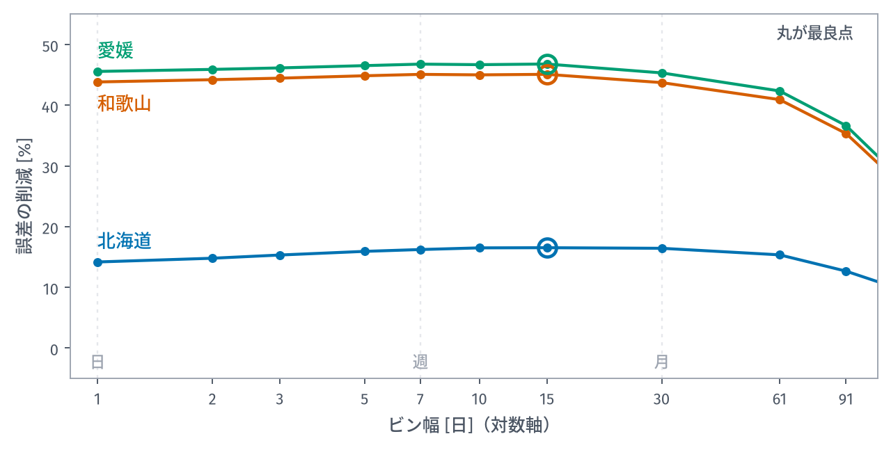
*縦軸は「季節を考えない場合に比べて誤差が何 % 減ったか」。丸が最良点。比べるために、和歌山と愛媛（愛南町の周辺）でも同じことをした*

ぱっと見は平らです。1 日から 30 日まで、どこを取ってもあまり変わらないように
見える。ただし**端は確実に悪い**。1 日刻みにすると下がり、91 日まで広げるともっと
下がります。細かすぎても粗すぎてもいけない、という形にはなっています。

では、どこが最良なのか。削減率をそのまま見ても差が小さすぎて分からないので、
**最良点との差を、その差の標準誤差で割って**描き直します。同じデータの同じ
交差検証ですが、縦軸が変わるだけで谷がはっきりします。

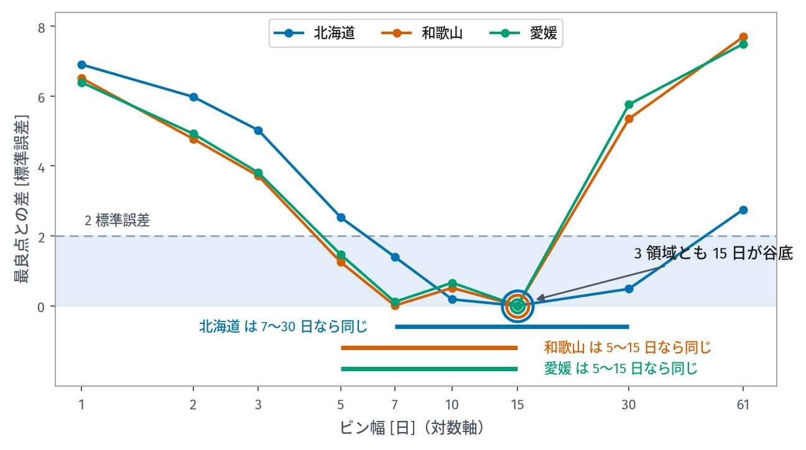
*縦軸 0 がその領域の最良点。上にあるほど悪い。水色の帯は最良点と統計的に区別できない範囲*

**3 つの領域とも 15 日が谷底**でした。

左側（細かく切る）に向かって急に悪くなるのは、1 区間あたりの標本が減るからです。
1 日刻みにすると 1 区間に 40 本しか入らず、その年たまたま吹いた風を「その日の
気候」と読み違えます。右側（粗く切る）に向かって悪くなるのは、季節の変化を
均してしまうからです。

ただし谷は平らです。**北海道は 7〜30 日、和歌山と愛媛は 5〜15 日のどこを選んでも、
統計的には区別がつきません**。15 日を選んだのは、その範囲の中で最良であり、かつ
境界が毎年同じ日付に来るからです。

別のやり方でも確かめました。区間で刻む代わりに、1 年を滑らかな波（調和関数）の重ね合わせで表し、波を何個まで使うかを変えていく方法です。

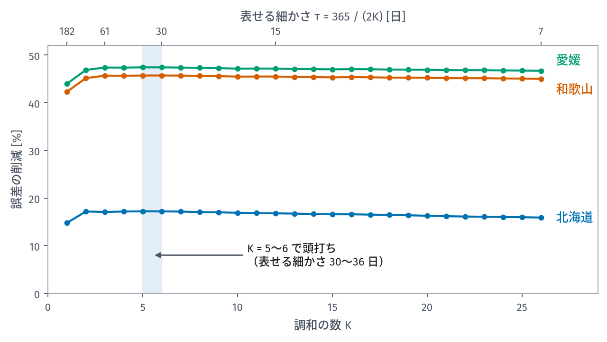

波を 5〜6 個あたりまで増やすと頭打ちになります。5 個の波が表せる細かさは $365 / (2 \times 5) = 36$ 日。つまり**実在するのは 1〜2 か月スケールの滑らかな季節変化**であって、「10 月第 3 週に固有の風」のようなものは、少なくとも 10 年のデータからは見えません。

そこで採用したのが**半月ビン**です。

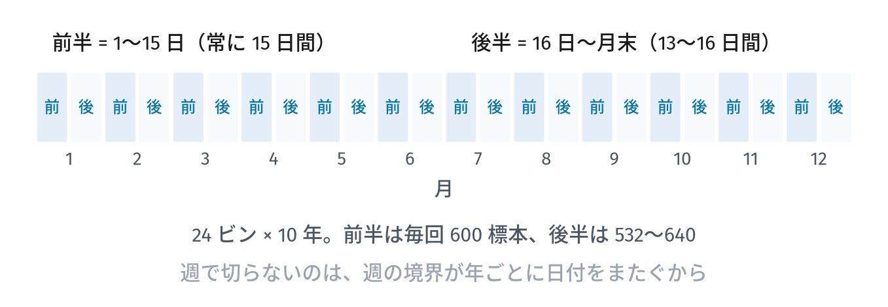

前半（1〜15 日）と後半（16 日〜月末）で切ります。週で切らないのは、週の境界が年ごとに日付をまたいでしまうからです。半月なら境界は毎年同じ日付に来ます。

### 600 標本が実質 77 標本にしかならない

ここで見落としやすい落とし穴があります。半月ビン 1 つには 6 時間ごと × 15 日 × 10 年 = **600 個**の解析値が入ります。標本数 600、と言いたくなります。

しかし 6 時間前の風と今の風はよく似ています。同じ低気圧の中にいるのだから当然です。実際、6 時間ずらしたときの自己相関は **0.975** もあります。

独立な標本が何個ぶんに相当するかを表す**有効標本数**という量があり、

$$
n_{\mathrm{eff}} = n \frac{1 - r_1}{1 + r_1}
$$

で計算します（$r_1$ がラグ 1 自己相関）。これを実データに当てると、中央値で **77.2**。生の標本数の **13 %** しかありません。

:::message alert
600 個あるつもりで誤差を見積もると、実際の $\sqrt{600/77} \approx 2.8$ 倍だけ楽観的な数字が出ます。この後に出てくる「どちらの分布が当てはまりが良いか」といった判断も、同じ倍率で過信の方向へずれます。3 回目でもう一度出てきます。
:::

## 風向は平均してはいけない

次の注意点はもっと基本的なもので、間違えると結果がまったく使えなくなります。

風向は角度です。角度をそのまま足して割ると、誤った答えになります。

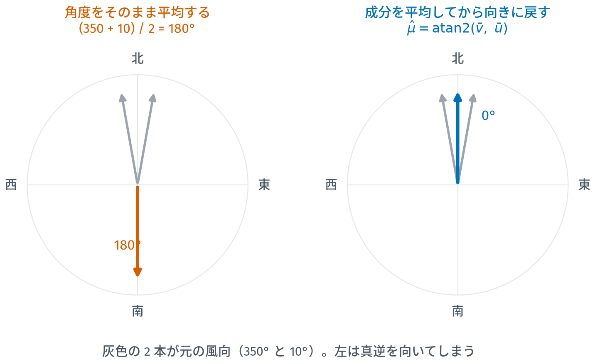

350 度と 10 度、どちらもほぼ北風です。算術平均を取ると $(350 + 10) / 2 = 180$ 度、つまり**真南**になります。2 つの北風を平均したら南風になった。

正しくは、風を東西成分 $u$ と南北成分 $v$ に分けて、成分ごとに平均してから向きに戻します。

$$
\hat\mu = \mathrm{atan2}(\bar v,\ \bar u)
$$

このデータベースでは、**角度を直接平均した値はどこにも置いていません**。すべて成分の平均から導いています。

### 副産物としての「定常度」

成分で平均すると、もう 1 つ便利な量が得られます。

- **ベクトル平均の大きさ** $|\bar{\mathbf V}|$ … 向きがばらばらなら打ち消し合って小さくなる
- **スカラー平均** $\overline{|\mathbf V|}$ … 向きに関係なく速さだけ平均したもの

この比を**定常度**（constancy）と呼びます。

$$
C = \frac{|\bar{\mathbf V}|}{\overline{|\mathbf V|}} \in [0, 1]
$$

1 に近ければ「その時期は毎回ほぼ同じ向きに吹く」、0 に近ければ「向きが定まらない」。平均風向を信じてよいかどうかが、この 1 つの数字で分かります。

## 北海道の姿

ここまでの方法で統計を取ると、北海道上空はこう見えます。ここからは代表の
打ち上げ地点の 24 ビン × 38 気圧面を、いろいろな角度から見ていきます。

### 全体像: 強さ

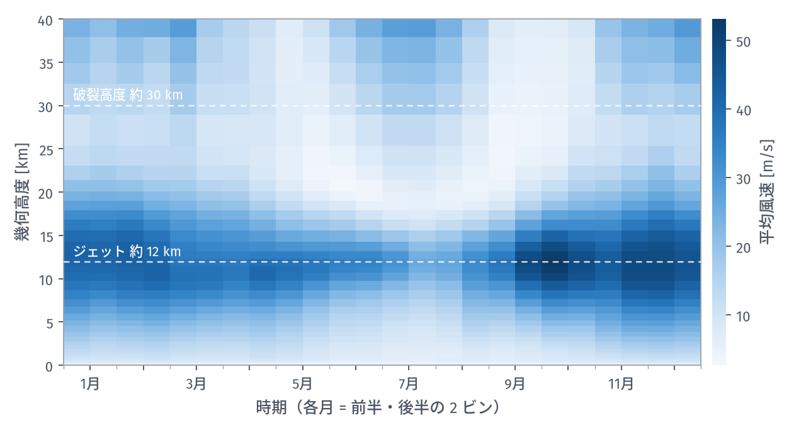
*縦が高度、横が 24 の半月ビン。色が濃いほど風が強い*

読み取れることが 3 つあります。

**高度 10〜13 km に、年間を通じて強い帯がある**。これがジェット気流です。地表から
数え上げていくと風は単調に強くなり、圏界面（対流圏と成層圏の境目）で最大になって、
その上では弱まります。

**その帯がいちばん濃いのは 9〜11 月**。冬ではありません。

**20〜25 km 付近に、夏だけ極端に弱い領域がある**。7 月前後、この高度は色がほとんど
抜けています。夏の成層圏は東風と西風が入れ替わる高度があり、そこでは平均すると
ほぼゼロになるのです。

秋にいちばん強くなる理由を、もう少し詳しく見ます。

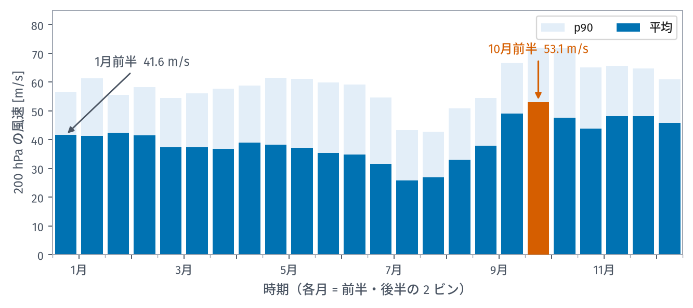
*濃い青が平均、薄い青が p90（上位 10 % の日の速さ）。代表地点の値*

| 季節 | 200 hPa の平均風速（領域平均） |
|---|---:|
| 冬 | 40.2 m/s |
| 春 | 35.0 m/s |
| 夏 | 29.9 m/s |
| **秋** | **44.5 m/s** |

代表地点で見ると 10 月前半が 53.1 m/s で最大、1 月前半は 41.6 m/s です。

なぜ秋なのか。理由はジェットの**強さ**ではなく**位置**です。東アジアのジェットは
季節とともに南北に動きます。冬のジェットは確かに強いのですが、芯は本州の南に
下がっていて、北海道はその北の縁にかかるだけ。10〜11 月はその芯がちょうどこの
緯度帯を通過します。

:::message
同じ処理を和歌山や愛媛（愛南町の周辺）にかけると、200 hPa の冬はどちらも **75 m/s** 台。北海道の冬の約 2 倍です。
「冬のジェットが強い」は日本全体では正しく、北海道では成り立ちません。
**帯状平均や全国的な傾向を、一部だけ切り取った領域にそのまま当てはめてはいけない**
という話が、このあともう一度出てきます。
:::

### 全体像: 向き

強さだけ見ていても飛行計画は立ちません。どちらへ流されるかのほうが重要です。

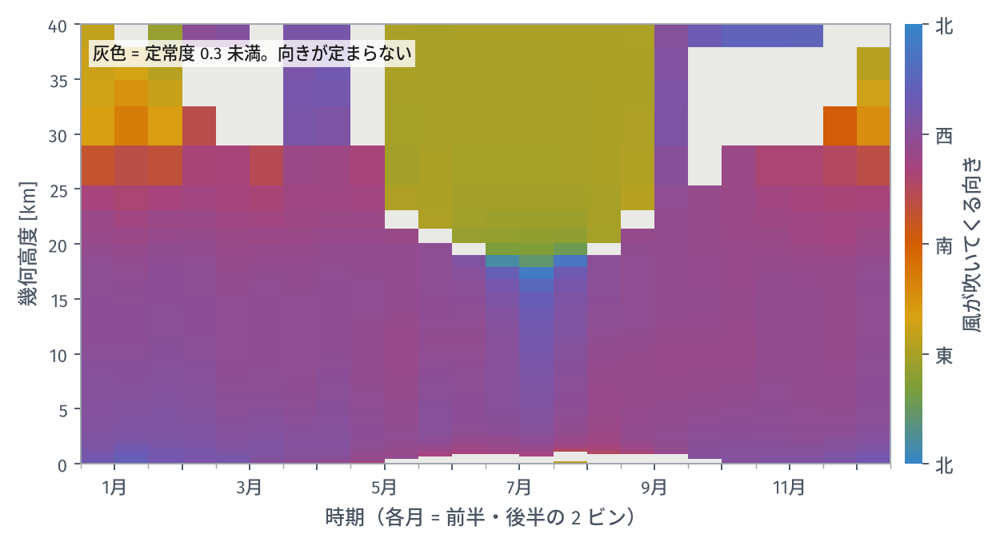
*色が「風が吹いてくる向き」。定常度 0.3 未満、つまり向きが定まらないところは灰色*

この図から、スペースバルーンの計画に必要なことの多くが読み取れます。

**高度 25 km あたりまでは、年間を通じて紫〜赤紫**。これは「西から吹いてくる」、
つまり機体は東へ流される、という意味です。偏西風帯なので当然といえば当然です。

**夏だけ、20 km より上がオリーブ色に変わる**。「東から吹いてくる」、つまり西へ
流される。成層圏の夏は東風なのです。境目は 5 月と 9 月にあり、そこで色が切り替わり
ます。

**その切り替わりの時期に、灰色の領域が広がる**。春と秋の 25 km 以上は、平均風向を
出しても意味がないほど向きが散らばっています。

**下から上まで同じ向きの季節は、冬と夏だけ**。春と秋は、下層が西風で上層の向きが定まらない
という混ざった状態になります。

### 季節ごとの縦断面

同じことを、4 つの季節の鉛直プロファイルとして描くとこうなります。

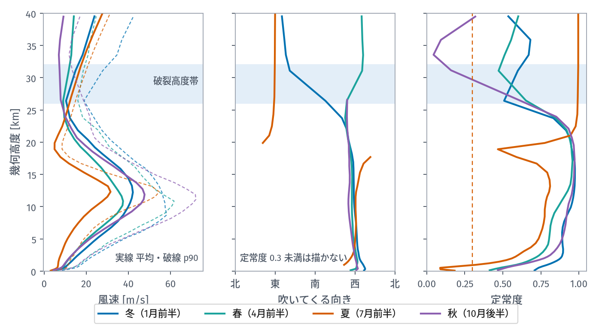
*左から、風速・吹いてくる向き・定常度。水色の帯が破裂高度帯（26〜32 km）*

左の図で、夏（朱）だけが他と違う形をしています。ジェットの山が低く、しかも
高度 20 km 付近でいったん最小になってから、上でまた増える。この「上でまた増える」
のが成層圏の東風です。

中央の図を見ると、夏（朱）だけが 20 km より上で左端（東）に振り切れています。
他の季節は上から下まで「西」の近くに縦に並んでいる。

右の図（定常度）では、破裂高度帯で秋（紫）が 0.1 付近まで落ちています。
**同じ高度でも、風向が安定しているかどうかは季節によって変わる**のです。

### 層ごとにまとめる

スペースバルーンの飛行を考えるときは、38 面を個別に見るより、意味のあるまとまり
で見るほうが
実用的です。

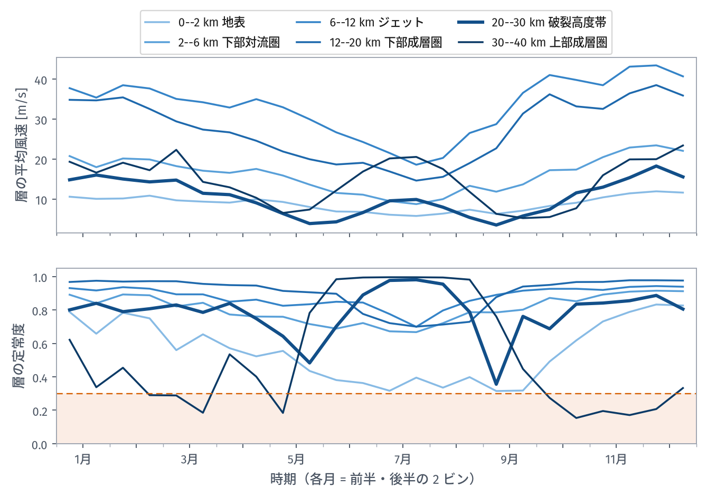
*上が層の平均風速、下が層の定常度。太い線が破裂高度帯*

上の図から、**層によって年変化の形がまるで違う**ことが分かります。

- ジェット層（6〜12 km）と下部成層圏（12〜20 km）は、秋から冬に強まり夏に弱まる
- 破裂高度帯（20〜30 km、太線）は逆で、**夏に山がある**
- 上部成層圏（30〜40 km）はさらに極端で、5 月と 9 月に谷、冬と夏に山

つまり「夏は風が弱い」というのは対流圏の話で、破裂高度帯では夏のほうが強いのです。

下の図（定常度）はもっと実用的です。**破裂高度帯の太線は、夏に 1.0 近くまで上がり、
10 月から 12 月にかけて 0.3 を割り込みます**。この期間、破裂高度で機体がどちらへ
流れるかは予測できません。

### 破裂高度帯で風向が定まらない時期

いちばん気になるのがここなので、2 つの高度を直接比べます。

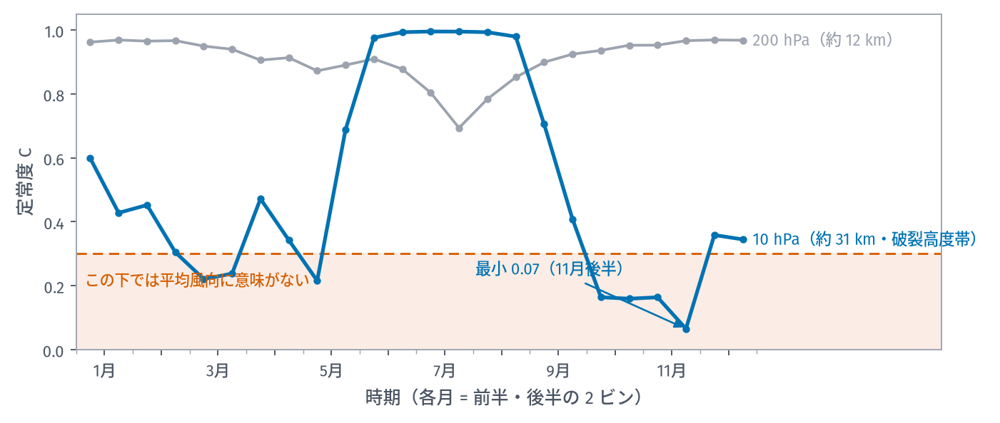
*濃い青が 10 hPa（約 31 km・破裂高度帯）、灰色が 200 hPa（約 12 km）*

灰色の 200 hPa は、年間を通じて 0.69 を下回りません。対流圏の向きは安定しています。

濃い青の 10 hPa はまったく違います。6〜8 月はほぼ 1.0（完全に一方向）なのに、
**10 月から 12 月にかけて 0.07 まで落ちる**。2〜5 月にも 0.3 を割る時期があります。

| 季節 | 10 hPa の定常度（領域平均） |
|---|---:|
| 夏 | 0.99 |
| 春 | 0.36 |
| 秋 | 0.31 |

分布で見ると、何が起きているか一目で分かります。

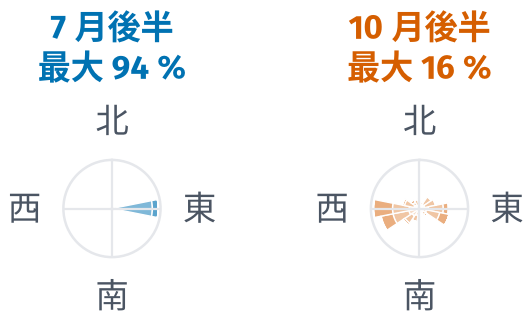
*左が 7 月後半、右が 10 月後半。同じ標本数・同じ高度*

7 月後半は 1 つの方向に 94 % が集中しています。10 月後半は最大の方位でも 16 %
しかなく、ほぼ全方位に散らばっている。

:::message alert
大事なのは、**データが足りないのではない**ということです。標本は同じだけあります。
実際に向きが定まっていないのです。

春と秋は成層圏の風が東風と西風の間で切り替わる時期で、年によって、日によって
向きが違う。平均風向を計算することはできますが、それを信じて飛行計画を立てては
いけません。
:::

### 冬の 30 km は東風だった

もう 1 つ、教科書どおりでない結果が出ました。

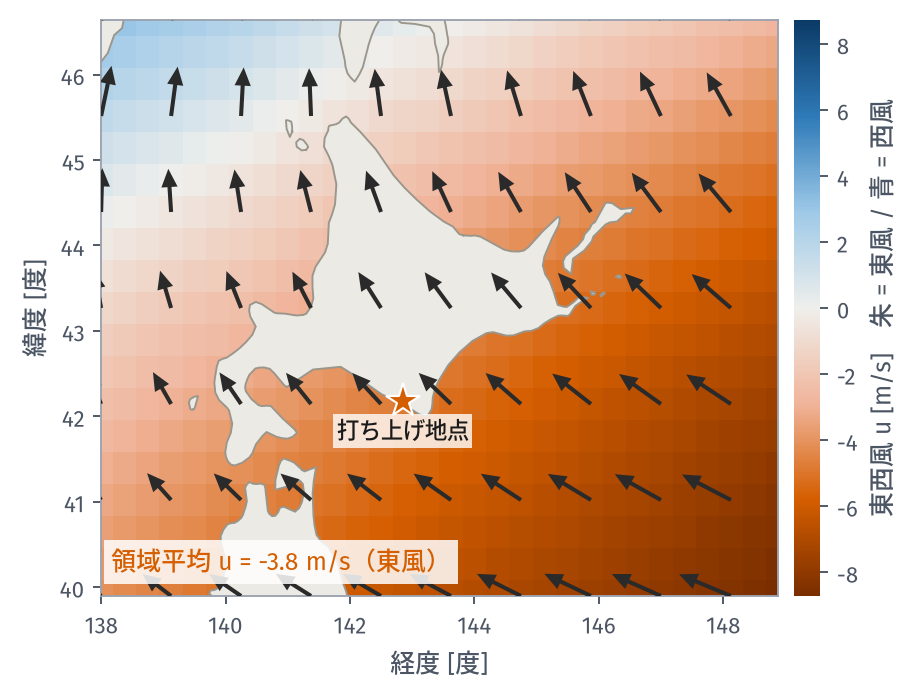
*朱色が東風、青が西風。矢印は平均風ベクトル（機体が進む向き）*

北海道上空 10 hPa の 1 月、領域平均の東西風は **−3.8 m/s**、つまり**東風**です。
冬の成層圏は西風、というのが帯状平均（緯度円を一周した平均）での常識ですから、
符号が逆です。矢印もすべて北西へ向いています。

原因は**アリューシャン高気圧**でした。冬の成層圏にはアリューシャン列島付近を
中心とする高気圧性の循環があり、北海道上空はその西の縁にあたります。高気圧の
周りを時計回りに回る流れなので、西縁では北向き〜北西向きになるのです。図で
北西ほど青（西風）、南東ほど朱（東風）になっているのは、その循環の縁を斜めに
切っているからです。

これは最初、こちらの計算ミスだと思いました。帯状平均を前提に書いた検算コードが
「西風のはず」と判定したからです。実際には検算コードのほうが間違っていました。

**帯状平均の性質は、一部の経度だけを切り取った領域には当てはまらないことがあります。**

## 北海道では、時期を知っても誤差は 17 % しか減らない

ここまで読むと「北海道の風は季節でよく決まっている」という印象を持つかもしれません。実際はそうではありません。

冒頭の交差検証をもう一度使います。「季節をまったく考えない場合の誤差」と「最良の半月ビンを使った場合の誤差」を比べると、

| | 季節を考えない | 最良ビン | 誤差の削減 |
|---|---:|---:|---:|
| **北海道** | 93.6 km | 78.1 km | **17 %** |
| 和歌山 | 118.2 km | 64.9 km | **45 %** |
| 愛媛 | 118.7 km | 63.2 km | **47 %** |

**北海道は 17 % しか減りません**。同じ手順、同じ期間、同じ解像度で処理した和歌山と愛媛が 45〜47 % 減るのと対照的です。

分散でいえば、気候値が説明できるのは北海道で **30 %**、和歌山で 70 %、愛媛で 72 %。気候値で説明できるのはここまでです。

なぜこんなに差がつくのか。高度別に見ると傾向が見えます。

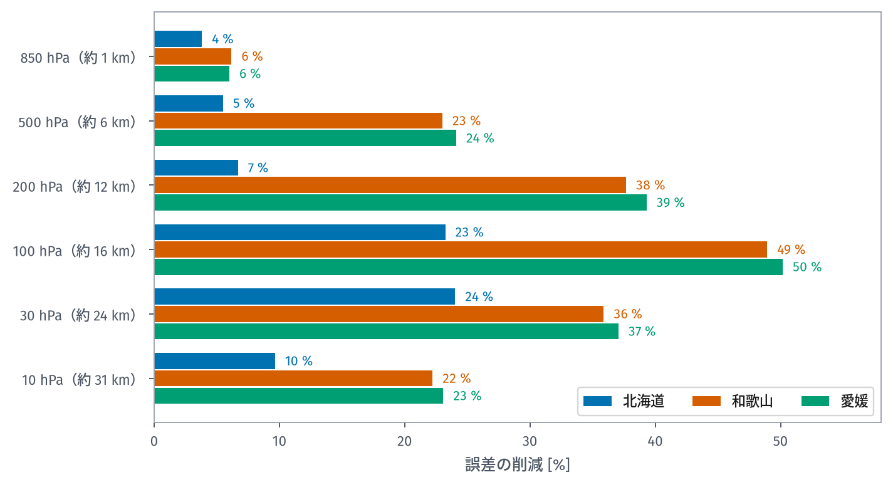

| 気圧面 | 高度 | 北海道 | 和歌山 | 愛媛 |
|---|---|---:|---:|---:|
| 850 hPa | 約 1.5 km | 4 % | 6 % | 6 % |
| 500 hPa | 約 5.5 km | 5 % | 23 % | 24 % |
| 200 hPa | 約 12 km | **7 %** | 38 % | 39 % |
| 100 hPa | 約 16 km | 23 % | 49 % | 50 % |
| 30 hPa | 約 24 km | 24 % | 36 % | 37 % |

北海道の対流圏（〜200 hPa）は **4〜7 %**。時期を知っても、この高さの風はほとんど予測できません。誤差が 2 割以上減るのは、100 hPa より上の成層圏だけです。

原因は、平年からのずれがどれだけ長く続くかにあります。

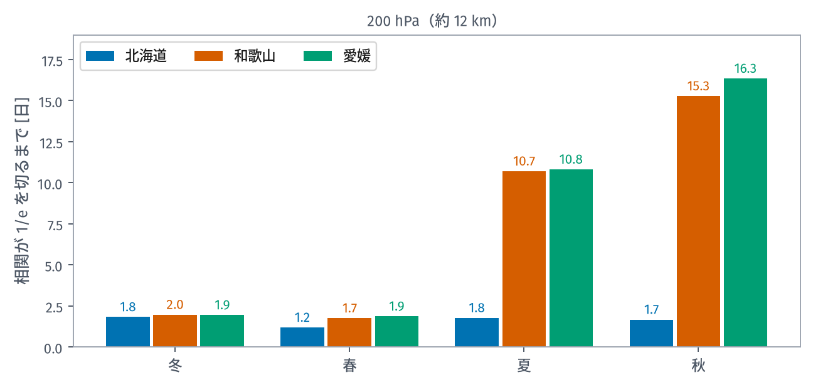
*自己相関が 1/e を切るまでの日数。200 hPa（約 12 km）で季節ごとに測った*

200 hPa で偏差が続く時間は、北海道が **1.2〜1.8 日**、和歌山と愛媛が夏秋で **10.7〜16.3 日**。北海道の上空は、2 日経つと前の日と無関係な風になります。

和歌山や愛媛の夏は太平洋高気圧に覆われて流れが止まるので、同じ状態が 2 週間続く。北海道は偏西風の通り道で、低気圧が次々に通過していく。**流れが止まらないので、同じ状態が長く続きません。**

風の分散を分解すると、この事情がはっきりします。

| 成分 | 北海道 | 和歌山 | 愛媛 |
|---|---:|---:|---:|
| 季節変化 | **18 %** | 45 % | 47 % |
| 季節内の日々の天気 | **71 %** | 48 % | 47 % |
| 日変化（1 日の中） | 11 % | 6 % | 6 % |

北海道では、季節が決めているのは 2 割もありません。7 割は「その日の天気」で、これは気候値では予測できない部分です。南の 2 か所でも季節が決めているのは半分以下です。

## 南の打ち上げ地点: 愛媛県愛南町では

北海道のほかに、愛媛県の南端、愛南町の周辺にも打ち上げ地点の候補があります。そこで同じ処理を愛南町の周りにもかけました。代表地点は南レク御荘公園（北緯 32.964 度、東経 132.552 度）です。

範囲は北緯 31.5〜34.5 度、東経 132.0〜136.0 度の 108 格子点で、打ち上げ地点を中心にしていません。今回データを取った範囲の西の端が、愛南町の西わずか 50 km にあるためです。そのかわり東へ伸ばしました。この地点から上げた機体は 1 年の大半を東へ流されるので、統計が要るのも東側です。

結果をひと言でまとめると、**愛南町の上空は和歌山とほぼ同じ**でした。

| | 北海道 | 和歌山 | 愛媛 |
|---|---:|---:|---:|
| 200 hPa の冬の平均風速 | 40.2 m/s | 75.5 m/s | 75.4 m/s |
| 時期を知って減らせる誤差 | 17 % | 45 % | 47 % |
| 1 日遅れたときの落下点の移動（季節別の中央値） | 43〜63 km | 30〜50 km | 29〜48 km |

愛南町と和歌山は経度が 2 度違いますが、緯度がほぼ同じなので同じジェットの下にあります。北海道との差を決めているのは、東西の位置ではなく南北の位置です。

北海道と違うのは、**夏に飛ぶ向き**です。7 月前半は東へ、7 月後半から 8 月は西へ、9 月前半は北東へと、半月ごとに向きが入れ替わります。夏は対流圏の弱い西風と成層圏の東風がほぼ釣り合うので、どちらがわずかに強いかで向きが決まるのです。

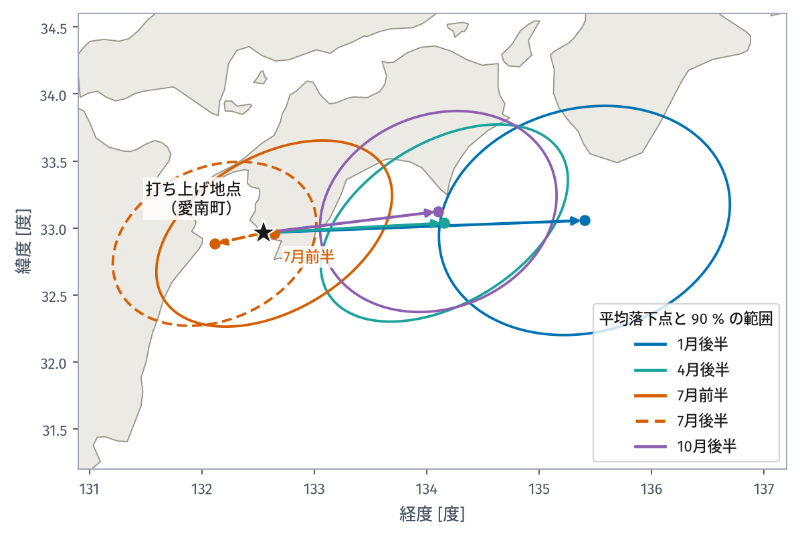
*矢印の先が平均落下点、楕円がその 90 % の範囲。夏は向きが入れ替わるので、7 月は前半（実線）と後半（破線）を分けて描いた*

平均落下点を、陸か海か、岸から何 km かで整理するとこうなります。陸に落ちる場合の「岸まで」は、海岸から内陸へ入った距離です。

| 時期 | 1 回あたりの飛行距離 | 平均落下点 | 岸まで |
|---|---:|---|---:|
| 1 月後半 | 270 km | 海（潮岬の西南西） | 54 km |
| 4 月後半 | 155 km | 海（室戸岬の南） | 24 km |
| 7 月前半 | 53 km | **陸** | 5 km |
| 7 月後半 | 59 km | 海（豊後水道） | 10 km |
| 10 月後半 | 151 km | 海（室戸岬の南） | 15 km |

7 月前半の平均落下点は、打ち上げ地点から東へわずか 9 km です。ところが 1 回ごとの飛行は 53 km あります。**東へ行く日と西へ行く日が打ち消し合うので、平均すると打ち上げ地点のすぐそばになる**のです。夏は平均の矢印ではなく楕円のほうを見てください。楕円は陸にも海にもかかっているので、回収の手配は両方に備えておく必要があります。

:::message
配布を予定しているのは北海道の分です。愛南町と和歌山の統計は、比べるために同じ手順で作ったもので、今回の配布には含めません。
:::

## この統計が言えないこと

まとめる前に、はっきり書いておきます。

**日単位の話はできません**。1 日刻みの統計は、最良のビン幅より 6 標準誤差以上悪くなります。

**北海道では、半月ごとの違いに意味はありません**。月単位と統計的に区別がつきません（+0.5 SE）。「10 月前半と 10 月後半でどちらがよいか」には答えられない。

**地表付近には使えません**。850 hPa の誤差削減はわずか 4〜6 %。格子が 40 km なので、日高山脈は 2〜3 点にしか乗らず、地形による風はまったく表現されていません。

**予報の誤差は入っていません**。ここで測った 3〜5 km の近似誤差は、予報が完璧だと仮定したときの下限です。

**10 年は短い**。成層圏には約 2 年周期の振動（QBO）があり、10 年では 4〜5 周期しか入りません。平均しきれていない可能性があります。

**気圧面の統計であって、一定高度の統計ではありません**。同じ 200 hPa でも、冬は夏より 500 m ほど低い位置にあります。

## 次回

作った統計は NetCDF ファイル 1 つ、61 MB になりました。ところがこれを誰かに渡しても、xarray の使い方と次元の並び順を知らなければ 1 地点の値すら取り出せません。

[3 回目][part3]は、これを **DuckDB** に組み替えて「SQL で引ける形」にする話です。分布を当てはめて、**表の 1 行から確率分布を再現できる**ようにしたので、1 回目で挙げた課題「モンテカルロに風のばらつきを入れる」にも答えます。

---

## 図とデータについて

この記事の図はすべて **JRA-3Q 再解析**から作った派生物です。JRA-3Q は気象庁が作成し、NSF NCAR GDEX がデータセット `d640000` として配布しています。

これらの図は **CC BY-NC-SA 4.0**（表示・非商用・継承）で提供されます。本文とコードは別のライセンスです。

> Kosaka, Y., S. Kobayashi, Y. Harada, C. Kobayashi, H. Naoe, K. Yoshimoto, M. Harada, N. Goto, J. Chiba, K. Miyaoka, R. Sekiguchi, M. Deushi, H. Kamahori, T. Nakaegawa, T. Y. Tanaka, T. Tokuhiro, Y. Sato, Y. Matsushita, and K. Onogi, 2024: The JRA-3Q Reanalysis. *J. Meteor. Soc. Japan*, **102**, 49-109. doi:10.2151/jmsj.2024-004

アリューシャン高気圧については Harvey, V. L. and M. H. Hitchman, 1996: A Climatology of the Aleutian High. *J. Atmos. Sci.*, **53**, 2088-2101 を参照しました。円周統計の扱いは Mardia, K. V. and P. E. Jupp, 2000: *Directional Statistics*, Wiley によります。

<!-- 公開時にここだけ書き換える。your-id を自分の Zenn ID に。 -->

[part1]: https://zenn.dev/your-id/articles/balloon-wind-1-forecast-limit
[part2]: https://zenn.dev/your-id/articles/balloon-wind-2-building-climatology
[part3]: https://zenn.dev/your-id/articles/balloon-wind-3-duckdb-distribution
