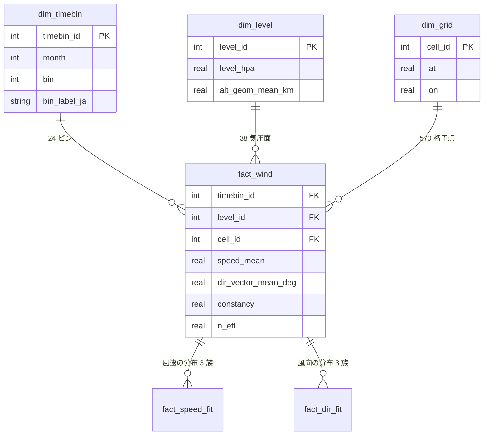
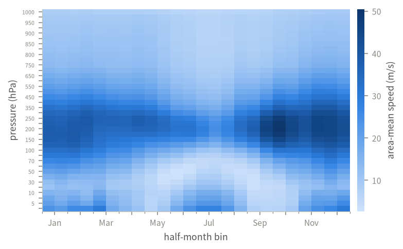
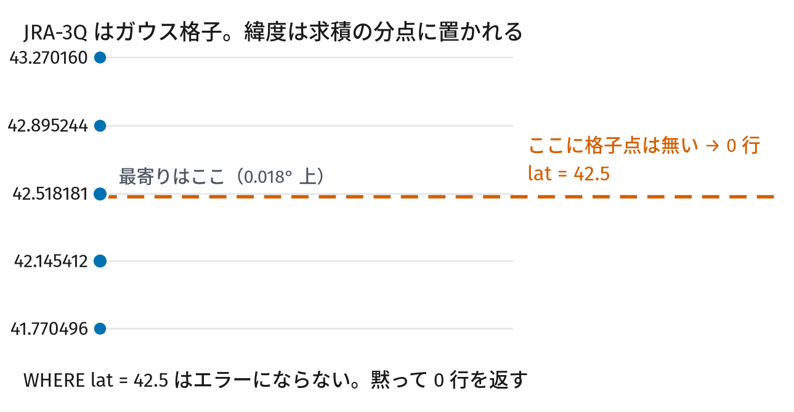
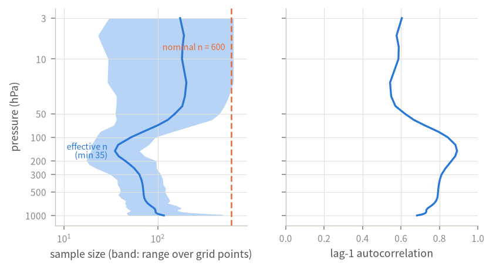
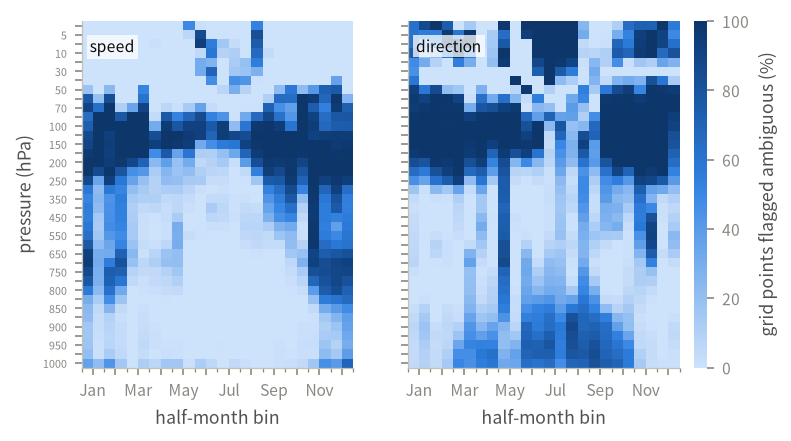
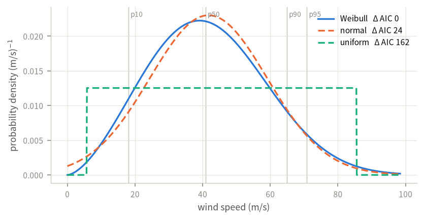
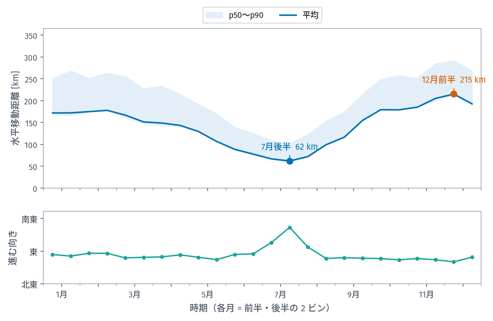
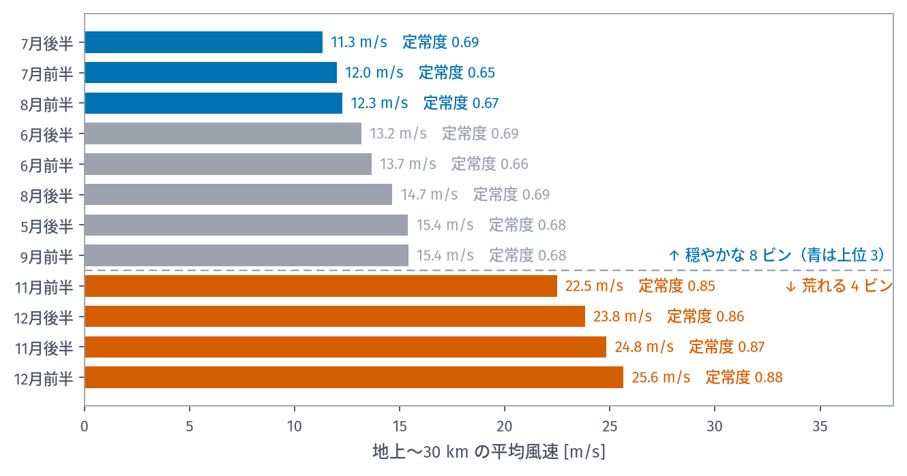

[前回][part2]、JRA-3Q 再解析の 10 年ぶんから北海道上空の統計風を作りました。できあがったのは NetCDF ファイル 1 つ、61 MB です。

ところがこれを誰かに渡しても、たぶん使ってもらえません。xarray の使い方を知っていて、次元の並び順を覚えていないと、1 地点の値すら取り出せないからです。

今回は、これを **DuckDB** に組み替えて「SQL で引ける形」にする話です。ついでに確率分布を当てはめて、**表の 1 行から分布を再現できる**ようにしました。第 1 回で課題として挙げた「モンテカルロに風のばらつきを入れる」にも、ここで答えます。

1. [落下予測は 7 日先で止まる][part1]
2. [再解析 10 年ぶんから統計風を作る][part2]
3. **DuckDB で配る、そして使う**（この記事）

## なぜ DuckDB か

:::message
**DuckDB とは**: 1 つのファイルで完結するデータベースです。サーバを立てる必要も、ユーザ登録も設定ファイルもありません。`.duckdb` という拡張子のファイルを開くだけで使えます。

仕組みは SQLite に近く、用途が違います。SQLite は「1 行を読み書きする」のが得意で、DuckDB は「何百万行を一度に集計する」のが得意です。
:::

今回のデータは 480 万行あり、そのほとんどは 1 行ずつではなく、絞り込んで集計して使うものです。そういう形に向いています。

```bash
pip install duckdb
duckdb -readonly jra3q_hokkaido_wind_2016-2025_v1.duckdb
```

これだけで引けます。

## 中身の形

一般的な星型スキーマにしました。「いつ」「どこ」を定義する**次元表**と、測った値を持つ**ファクト表**に分かれています。



| 表 | 行数 | 中身 |
|---|---:|---|
| `dim_timebin` | 24 | 半月ビン |
| `dim_level` | 38 | 気圧面 |
| `dim_grid` | 570 | 格子点 |
| `fact_wind` | 519,840 | 統計量 34 変数 |
| `fact_speed_fit` | 1,559,520 | 風速の分布 3 族 × 全セル |
| `fact_dir_fit` | 1,559,520 | 風向の分布 3 族 × 全セル |


*データベース全体を 1 枚にするとこうなる。横が 24 ビン、縦が 38 気圧面*

設計上、あえて冗長にしたところが 1 つあります。ファクト表の各行は、`timebin_id` のような番号（代理キー）と、`month` `level_hpa` `lat` `lon` といった実際の値の**両方**を持っています。正規化の観点では冗長ですが、そのおかげで次のように結合なしで絞り込めます。

```sql
SELECT lat, lon, speed_mean
FROM fact_wind
WHERE month = 1 AND bin = 1 AND level_hpa = 200;
```

## 使う前の注意点

使い始める前に知っておいてほしいことが 2 つあります。どちらも、知らないと**エラーにならないまま間違った結果が出ます**。

### 1. `lat = 42.5` は 0 行を返す

JRA-3Q は**ガウス格子**という格子を使っています。これは球面調和関数を使うモデルが用いるもので、緯度がガウス・ルジャンドル求積の分点に置かれます。等間隔ではありません。



打ち上げ地点の緯度は普通、半端な小数です。ところが `WHERE lat = 42.5` と書くと、**エラーにならないまま 0 行**が返ってきます。

これを避けるため、最寄り格子点を返すマクロをデータベース自体に入れました。

```sql
SELECT * FROM nearest_cell(42.182306, 142.850972);
```

```
cell_id  lat        lon      gauss_weight  distance_km
    193  42.143574  142.875      0.004848     4.740348
```

:::message
**マクロとは**: 引数を取れるビュー（保存しておいたクエリ）です。DuckDB では表マクロとして定義でき、テーブルと同じように `FROM` に書けます。
:::

### 2. AIC の差は水増しされている

前回書いた**有効標本数**の話が、ここで関係してきます。

分布の当てはめでは、1 ビンの 600 本が独立であるかのように対数尤度を計算しています。しかし実際の有効標本数は平均 99、少ないところでは 17 しかありません。尤度は標本数に比例するので、**モデル選択に使う AIC の差も同じ倍率だけ水増しされます**。


*左の破線が名目の標本数 600。実線が有効標本数*

倍率 $n / n_{\mathrm{eff}}$ は平均 **8.6 倍**、最大 37 倍。そこで全行に `n_eff` を持たせ、割り引いた差 `delta_aic_effective` をビューに出し、それが 2 を下回る勝者には `is_ambiguous` を立てました。



実際にどのくらい曖昧かというと、

| 量 | 選ばれた族 | 割合 | うち曖昧 |
|---|---|---:|---:|
| 風速 | Weibull | 86.3 % | 22.2 % |
| 風速 | 正規 | 13.7 % | 72.1 % |
| 風向 | von Mises | 86.1 % | 33.0 % |
| 風向 | 巻き付け正規 | 13.5 % | 83.7 % |

正規分布が選ばれた面の **7 割**は曖昧です。`is_selected` が真であることは「この族が正しい」という意味ではなく、「この標本ではこの族がわずかに良かった」という意味でしかありません。

## 1 行が 1 つの分布

落下位置のモンテカルロをやるには、平均値だけでは足りません。風速の**分布**が要ります。そこで各セル（時期 × 気圧面 × 格子点、全 519,840 通り）について、確率分布を当てはめました。

風速には 3 族、風向にも 3 族。どれも同じ基準（AIC）で比べています。

| 量 | 候補 |
|---|---|
| 風速 | 正規 / Weibull（位置 0 固定）/ 一様 |
| 風向 | von Mises / 巻き付け正規 / 円周一様 |


*実線が選ばれた族。縦線は別に計算して保存してある分位点*

:::details なぜ風向に Weibull を使わないのか
風速と同じ 3 族を風向にも当てはめれば揃いが良さそうに見えますが、意味がありません。

Weibull の台は $[0, \infty)$ の直線です。円周上では 359 度と 1 度は 2 度しか離れていませんが、直線上では 358 度離れている。角度の原点を北から東に移すだけで、推定される形状と尺度が変わってしまいます。

当てはまりが悪いから外したのではなく、**量の性質に合わない**ので候補にしていません。この理由はデータベースの中（`meta_fit_family` 表）にも書いてあります。
:::

### 定数を埋め込んだ式が返る

族ごとに場合分けを書くのは面倒です。そこで、**そのセルの定数を埋め込んだ式を文字列で返す**列を用意しました。

```sql
SELECT level_hpa, speed_pdf, speed_sample
FROM fits_at(42.182306, 142.850972, 10, 2)
WHERE level_hpa = 200;
```

```
level_hpa    | 200.0
speed_pdf    | f(x) = (2.98254176/53.425525) * (x/53.425525)^(2.98254176-1)
             |        * exp(-(x/53.425525)^2.98254176),  x >= 0, x in m/s
speed_sample | x = 53.425525 * pow(-ln(1-u), 1/2.98254176)
```

`speed_sample` は逆関数法の式です。一様乱数 $u \in (0,1)$ を代入すれば、その面の風速が 1 つ得られます。**この 1 行と乱数だけで分布を再現できます。**

`fits_at(緯度, 経度, 月, ビン)` は最寄り格子点の探索まで済ませて、38 面ぶんをまとめて返します。打ち上げ地点の 10 月後半だとこうなります。

```
level_hpa  alt_km  speed_family      dir_family  k_or_sigma  lam_or_mu  dir_deg  kappa
    850.0     1.5  weibull_min_loc0  von_mises         2.02       11.9      274    1.7
    500.0     5.6  weibull_min_loc0  von_mises         2.19       27.5      264    4.2
    200.0    11.9  weibull_min_loc0  von_mises         2.98       53.4      256    9.8
    100.0    16.3  normal            von_mises         8.56       32.8      256   17.2
     30.0    23.9  weibull_min_loc0  von_mises         1.51       11.2      249    2.2
     10.0    31.1  weibull_min_loc0  von_mises         1.79        8.2      247    0.2
```

いちばん下の行、10 hPa（約 31 km）の `kappa` が **0.2** しかないことに注目してください。von Mises の集中度がこの値ということは、向きがほとんど定まっていないという意味です。前回見た「秋の破裂高度帯は風向が定まらない」が、そのまま数字に出ています。

## 使う: モンテカルロに風を入れる

第 1 回で挙げた課題に戻ります。**機体パラメータだけを振ると、落下点の散らばりは実際の 1 割しか出ない**。ここを直します。

### 各層を独立に引くと散らばりが小さく出る

まず、やってはいけない書き方から。

```python
import duckdb
import numpy as np
from scipy import stats

con = duckdb.connect("jra3q_hokkaido_wind_2016-2025_v1.duckdb", read_only=True)
rows = con.execute("""
    SELECT * FROM fits_at(42.182306, 142.850972, 10, 2)
    ORDER BY alt_geom_mean_km
""").fetchdf()

rng = np.random.default_rng(0)
for _, r in rows.iterrows():
    # 各層を独立に引く ← これが間違い
    speed = stats.weibull_min(r.weibull_shape, 0, r.weibull_scale_ms).rvs(
        1000, random_state=rng)
```

これだと、**散らばりが 3 分の 1 に縮みます**（第 1 回の図の 2 番目のパネル、東西 SD 15 km）。実際の大気では、ある高度で風が強い日はその上下でも強いからです。独立に引くと層どうしが打ち消し合ってしまいます。

### 鉛直の相関を保つ

正しくは、各層の周辺分布は当てはめたまま、層どうしの連動だけを別に与えます。ガウス・コピュラを使うと、これを短いコードで書けます。

```python
# 層どうしの順位相関（観測から得たもの）を rank_corr に持っているとする
chol = np.linalg.cholesky(rank_corr)          # (38, 38)

n = 2000
z = rng.standard_normal((n, len(rows))) @ chol.T   # 相関のある正規乱数
u = stats.norm.cdf(z)                              # (0,1) の一様乱数に写す

speeds = np.empty_like(u)
for k, (_, r) in enumerate(rows.iterrows()):
    if r.speed_family == "weibull_min_loc0":
        dist = stats.weibull_min(r.weibull_shape, 0.0, r.weibull_scale_ms)
    elif r.speed_family == "normal":
        dist = stats.norm(r.mu_ms, r.sigma_ms)
    else:
        dist = stats.uniform(r.uniform_a_ms, r.uniform_b_ms - r.uniform_a_ms)
    speeds[:, k] = dist.ppf(u[:, k])               # 周辺分布はそのまま
```

`u` に相関を入れてから各層の分位点関数に通す。これで各層の分布を保ったまま、層どうしの連動だけを再現できます。

### 風向も振る

もう 1 つ、風向を固定してはいけません。固定すると横風方向の散らばりが消えます（第 1 回の図の 3 番目、南北 SD 5 km）。

```python
for k, (_, r) in enumerate(rows.iterrows()):
    mu = np.radians(r.mu_deg)
    if r.dir_family == "von_mises":
        theta = stats.vonmises(r.kappa, loc=mu).rvs(n, random_state=rng)
    elif r.dir_family == "wrapped_normal":
        # scipy に巻き付け正規は無い。正規から引いて巻き戻す
        raw = rng.normal(mu, np.radians(r.wn_sigma_deg), n)
        theta = (raw + np.pi) % (2 * np.pi) - np.pi
    else:
        theta = rng.uniform(-np.pi, np.pi, n)
```

:::message alert
`dir_family` が `von_mises` でも、`kappa` が小さい面では向きがほとんど決まっていません。上の 10 hPa のように `kappa = 0.2` なら、実質的に一様分布に近い。**分布が当てはまっても、向きが定まっているとは限りません。**
:::

これで、第 1 回で見た 5 番目のパネル（東西 SD 52 km / 南北 SD 50 km）に相当する散らばりが出ます。実測の 55 / 49 km とほぼ一致する水準です。

### 出てくる答えの例

こうして計算した落下距離を 1 年ぶん並べると、こうなります。


*上が距離（帯は p50〜p90）、下が機体の進む向き。上昇 5 m/s・破裂 30 km・降下 6 m/s の公称飛行*

いちばん短いのが 7 月後半の **62 km**、いちばん長いのが 12 月前半の **215 km**。
季節で **3.5 倍**違います。帯の広さ（p50〜p90）も夏に狭く冬に広い。つまり**夏は
近くに落ち、かつ落下点のばらつきも小さい**。

下の図が方位です。年間を通じておおむね真東ですが、**7 月だけ南東へ 20 度ほど
振れます**。これは前回見た成層圏の東風の影響です。上層で西へ押し戻される
ぶん、正味の向きが変わる。

打ち上げの計画に直接使うなら、こう並べ替えるほうが読みやすいかもしれません。


*地上〜30 km の層平均風速の順。穏やかな 8 ビンと荒れる 4 ビンを抜き出した*

**穏やかな順に 7 月後半・7 月前半・8 月前半**。いずれも層平均 11〜12 m/s です。
**荒れる順に 12 月前半・11 月後半・12 月後半**で、22〜26 m/s。倍以上違います。

ただし定常度を見ると逆転しています。穏やかな夏は 0.65〜0.69、荒れる冬は
0.85〜0.88。**夏は風が弱いかわりに向きが定まらず、冬は強いかわりに向きが揃う**。
「風が弱い日を選べばよい」とは限らないわけです。

この打ち上げ地点から上げた場合、平均落下点は**どの季節も海上**でした。岸からの距離は
7 月だけ 2〜4 km、他の季節は 55〜80 km 沖です。この地点では、季節で変わるのは
陸か海かではなく、**岸からの距離**です。回収に船を出すかどうかは、この距離で
判断することになります。

## 列の説明とライセンスはデータベースの中にある

列の意味を忘れたら、手引を開かなくてもデータベースから説明を引けます。240 列すべてに説明と単位が埋め込んであります。

```sql
SELECT table_name, column_name, units, description
FROM v_column_dictionary
WHERE column_name IN ('constancy', 'n_eff', 'bearing_deg');
```

ライセンスもファイルの中に入っています。ファイルだけを受け取った人でも条件を確認できます。

```sql
SELECT * FROM v_license;
```

## 配布について

北海道の統計風データは、**配布を予定しています**。

| | |
|---|---|
| 形式 | DuckDB ファイル 1 つ（約 296 MB） |
| 収録 | 2016〜2025 年、北海道周辺 570 格子点 × 38 気圧面 × 24 半月ビン |
| 中身 | 統計量 34 変数、当てはめた分布（風速 3 族・風向 3 族） |
| 手引 | 103 ページの PDF（同梱）。導入・データの構造・取扱上の注意・分布の定義・使い方の例・表と列の一覧 |
| ライセンス | **CC BY-NC-SA 4.0**（表示・非商用・継承） |

:::message alert
JRA-3Q の派生物なので**非商用限定**です。再配布するときは同じライセンスを付け、下記の引用を添えてください。
:::

公開先が決まりしだい、ここにリンクを追記します。

## まとめ

3 回を通して書いてきたことを並べます。

**予報で見られるのは 7 日先まで**。打ち上げの計画は何か月も前に立てるので、気候値が必要になる。

**気候値は予報の代わりではない**。1 日ずれれば落下点は 43〜63 km 動く。気候値が答えられるのは「この時期はおおむねこう」までで、特定の日については何も言えない。北海道では、時期を知っても落下位置の誤差が 17 % しか減らないことも、測ったとおりに書きました。

**それでも、現在のモンテカルロより実際に近い散らばりが出せる**。現在のモンテカルロは風を振っていないために、実際に起こりうる散らばりの 1 割しか出していません。分布を当てはめて鉛直相関を保ったまま振れば、実際とほぼ同じ大きさの散らばりが出ます。

**SQL で引ける形にすると、使える人が増える**。NetCDF のままなら xarray を知っている人しか使えませんが、SQL なら「どの列が何か」だけ分かれば引けます。分布の式まで表に入れておけば、手引を読まなくても再現できます。

同じ問題を抱えている方の役に立てば幸いです。

---

## 図とデータについて

この記事の図はすべて **JRA-3Q 再解析**から作った派生物です。JRA-3Q は気象庁が作成し、NSF NCAR GDEX がデータセット `d640000` として配布しています。

これらの図は **CC BY-NC-SA 4.0**（表示・非商用・継承）で提供されます。本文とコードは別のライセンスです。

> Kosaka, Y., S. Kobayashi, Y. Harada, C. Kobayashi, H. Naoe, K. Yoshimoto, M. Harada, N. Goto, J. Chiba, K. Miyaoka, R. Sekiguchi, M. Deushi, H. Kamahori, T. Nakaegawa, T. Y. Tanaka, T. Tokuhiro, Y. Sato, Y. Matsushita, and K. Onogi, 2024: The JRA-3Q Reanalysis. *J. Meteor. Soc. Japan*, **102**, 49-109. doi:10.2151/jmsj.2024-004

円周統計の扱いは Mardia, K. V. and P. E. Jupp, 2000: *Directional Statistics*, Wiley によります。

<!-- 公開時にここだけ書き換える。your-id を自分の Zenn ID に。 -->

[part1]: https://zenn.dev/your-id/articles/balloon-wind-1-forecast-limit
[part2]: https://zenn.dev/your-id/articles/balloon-wind-2-building-climatology
[part3]: https://zenn.dev/your-id/articles/balloon-wind-3-duckdb-distribution
